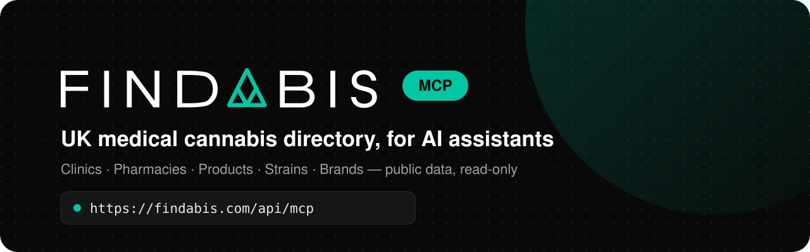
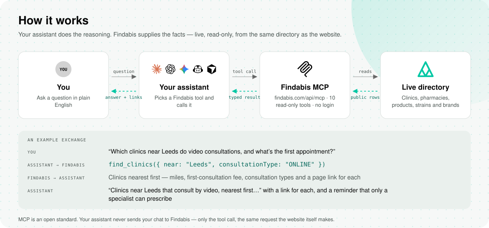
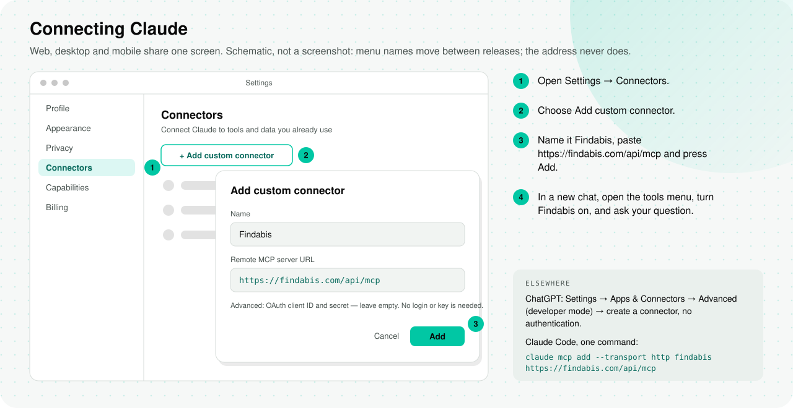
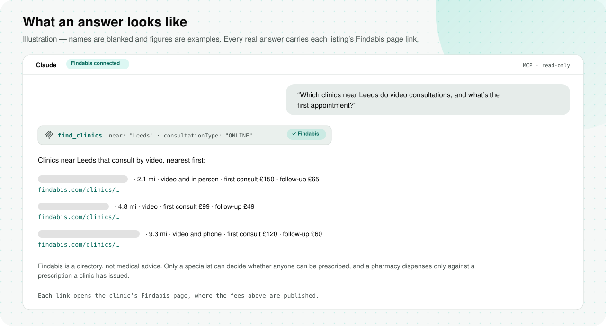
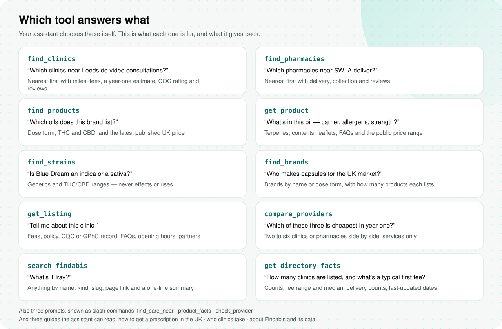
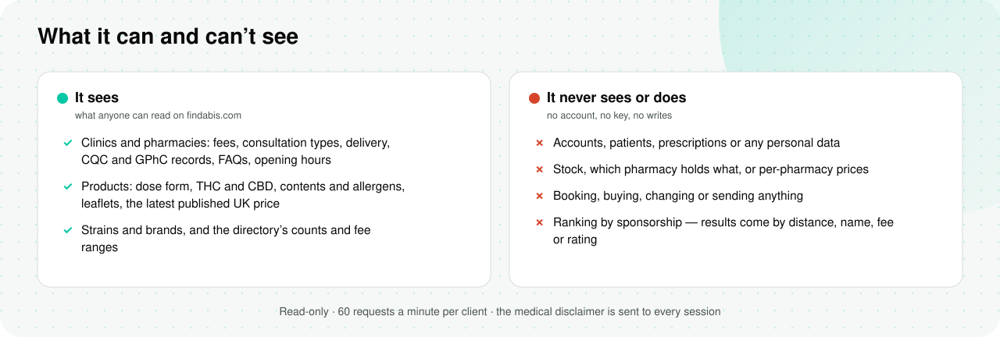

<div align="center">

<picture>
  <source media="(prefers-color-scheme: dark)" srcset="assets/banner-dark.svg">
  <source media="(prefers-color-scheme: light)" srcset="assets/banner-light.svg">
  
</picture>

<br/>

[](https://registry.modelcontextprotocol.io/)
[](#the-tools)
[](#what-it-can-and-cant-see)
[](LICENSE)

</div>

## What is this?

[Findabis](https://findabis.com) is a directory of UK medical cannabis clinics, pharmacies and products.

This MCP server lets AI assistants like Claude, ChatGPT and Gemini look things up in it directly, so answers about clinics, prices and products come from current data rather than guesswork.

It's hosted, so there's nothing to install or run.

## How it works

<picture>
  <source media="(prefers-color-scheme: dark)" srcset="assets/how-it-works-dark.svg">
  <source media="(prefers-color-scheme: light)" srcset="assets/how-it-works-light.svg">
  
</picture>

You ask your assistant a question. It picks one of the Findabis tools, calls it over the open [Model Context Protocol](https://modelcontextprotocol.io), and answers from what comes back, with a link to the Findabis page behind every fact. Your chat never goes to Findabis: only the tool call does, the same request the website itself makes.

## Getting started

Add this URL to your AI assistant:

```
https://findabis.com/api/mcp
```

That's it. No account, no API key.

### Claude (web, desktop and mobile)

<picture>
  <source media="(prefers-color-scheme: dark)" srcset="assets/connect-claude-dark.svg">
  <source media="(prefers-color-scheme: light)" srcset="assets/connect-claude-light.svg">
  
</picture>

1. Open **Settings → Connectors** and choose **Add custom connector**.
2. Name it **Findabis** and paste the URL above. Leave the OAuth fields empty: no login is needed.
3. In a new chat, open the tools menu, turn Findabis on, and ask your question.

### Claude Code

```bash
claude mcp add --transport http findabis https://findabis.com/api/mcp
```

### Cursor

[Add to Cursor](https://cursor.com/en/install-mcp?name=findabis&config=eyJ1cmwiOiJodHRwczovL2ZpbmRhYmlzLmNvbS9hcGkvbWNwIn0=) — one click. Or install it as a plugin: this repo follows the [Agent Plugins](https://agent-plugins.org) standard (`plugin.json` + `mcp.json`).

### Gemini CLI

```bash
gemini extensions install https://github.com/Findabis/MCP
```

### ChatGPT

1. Open **Settings → Apps & Connectors**. Custom servers sit under **Advanced settings** (developer mode).
2. Create a connector named **Findabis**, paste the URL above, and choose **No authentication**.
3. Add Findabis to a chat from the **+** menu and ask your question.

<details>
<summary><b>VS Code and GitHub Copilot, Windsurf, config files, and everything else</b></summary>

<br/>

**VS Code / GitHub Copilot** — add `.vscode/mcp.json` to your project (or run *MCP: Add Server* from the command palette), start the server from the file, then pick Findabis in Copilot Chat's tools list in agent mode:

```json
{
  "servers": {
    "findabis": { "type": "http", "url": "https://findabis.com/api/mcp" }
  }
}
```

**Cursor** by hand (`~/.cursor/mcp.json`):

```json
{
  "mcpServers": {
    "findabis": { "url": "https://findabis.com/api/mcp" }
  }
}
```

**Windsurf** (`~/.codeium/windsurf/mcp_config.json`):

```json
{
  "mcpServers": {
    "findabis": { "serverUrl": "https://findabis.com/api/mcp" }
  }
}
```

**Gemini CLI** by hand (`~/.gemini/settings.json`, then restart; `/mcp` lists the tools):

```json
{
  "mcpServers": {
    "findabis": { "httpUrl": "https://findabis.com/api/mcp" }
  }
}
```

**Anything else that speaks MCP:** streamable HTTP at the URL above (POST). A plain GET on the same URL returns a description of the server; the registry card lives at
[`/.well-known/mcp/server.json`](https://findabis.com/.well-known/mcp/server.json), and there's a copy in [`server.json`](server.json).

</details>

### Check it's working

Ask: *"How many clinics are listed on Findabis, and what does a first consultation typically cost?"*

Your assistant should call `get_directory_facts` and answer with counts, a fee range and links to the directory. If it answers from memory instead, Findabis isn't switched on in that chat yet (see [Troubleshooting](#troubleshooting)).

## What an answer looks like

<picture>
  <source media="(prefers-color-scheme: dark)" srcset="assets/example-answer-dark.svg">
  <source media="(prefers-color-scheme: light)" srcset="assets/example-answer-light.svg">
  
</picture>

Every answer links to the Findabis page it came from, so you can check a figure yourself. The server also reminds the assistant, on every connection, that Findabis is a directory and not medical advice.

## Things you can ask

- *"What's Blue Dream, and what does Findabis list for it?"*
- *"Which clinics near Leeds do video consultations, and what's the first appointment?"*
- *"Compare these three clinics on what a new patient pays in the first year."*
- *"What's actually in this oil — carrier oil, allergens, THC and CBD?"*
- *"Find me pharmacies near SW1A that deliver."*
- *"How many clinics are on Findabis, and what does a first consultation typically cost?"*
- *"Is this pharmacy registered, and what did its last GPhC inspection say?"*

## The tools

<picture>
  <source media="(prefers-color-scheme: dark)" srcset="assets/pick-a-tool-dark.svg">
  <source media="(prefers-color-scheme: light)" srcset="assets/pick-a-tool-light.svg">
  
</picture>

There are ten, and they all just read:

| Tool | What it's for |
|---|---|
| `find_clinics` | Clinics that can prescribe, nearest first from a postcode or town, with fees, consultation types, CQC rating and reviews |
| `find_pharmacies` | Pharmacies that dispense a prescription you already have, with delivery and collection |
| `find_products` | Products by name, brand, strain or form, with THC/CBD and the latest published UK price |
| `get_product` | Everything public about one product: strength, terpenes, ingredients, allergens, leaflets |
| `find_strains` | Strain profiles by name or genetics |
| `find_brands` | The brands behind UK products, by name or dose form, with how many products each lists |
| `get_listing` | One clinic, pharmacy, strain or brand page in full, with its FAQs and opening hours |
| `compare_providers` | Two to six clinics or pharmacies side by side |
| `search_findabis` | One search across the lot, plus Findabis articles, when you're not sure what you're looking for; every hit comes with a one-line summary |
| `get_directory_facts` | How many clinics, pharmacies, products, strains and brands are listed, the spread of first-consultation fees, how many pharmacies deliver |

The list tools return up to 25 at a time; pass `offset` for the next page (each answer says where it starts).

There are also three prompts, which show up as slash-commands in Claude Desktop, Claude Code and Cursor: `find_care_near` (a town or postcode), `product_facts` (a product name) and `check_provider` (a clinic or pharmacy name). And three guides the assistant can read: how to get a prescription in the UK, who clinics take, and what Findabis is.

## What it can and can't see

<picture>
  <source media="(prefers-color-scheme: dark)" srcset="assets/what-it-sees-dark.svg">
  <source media="(prefers-color-scheme: light)" srcset="assets/what-it-sees-light.svg">
  
</picture>

- It only sees what's already public on findabis.com. No accounts, no patients, no personal data — ever.
- It can't book, buy, change or send anything.
- It doesn't share stock levels, which pharmacy holds what, or per-pharmacy medicine prices. Those stay with patients and professionals who are signed in.
- Please be gentle with it: 60 requests a minute per client is plenty for normal use. Bulk-copying the directory isn't allowed under the [Findabis Terms](https://findabis.com/policies/terms).

## The important bit

> [!IMPORTANT]
> Findabis is a directory, not a clinic or a pharmacy, and nothing here is medical advice. It tells you what providers offer, never what anyone should take. That's a conversation for you and a specialist doctor.
>
> In the UK, cannabis-based medicines are prescription only, and only a specialist can prescribe them. Having cannabis without a prescription is still an offence.

The server tells your AI assistant all of this at the start of every session, so it should pass it on too.

## Troubleshooting

| What you see | What it means |
|---|---|
| The assistant answers without using Findabis | Findabis isn't switched on in that chat. In Claude, open the tools menu and turn it on; in Cursor and Gemini CLI, restart after adding the server. |
| `rate limit exceeded — wait a minute and retry` | 60 requests a minute from one address. A shared office or VPN address shares that budget. Wait a minute and ask again. |
| `Method Not Allowed: this server offers no SSE stream` | The client opened an old-style SSE connection. The server speaks streamable HTTP, so choose *HTTP* or *streamable HTTP* when adding it, or update the client. |
| `404 Not Found` | The address must be exactly `https://findabis.com/api/mcp`. Findabis customer websites and portal domains don't serve it. |
| A page link redirects to *coming soon* | Findabis hasn't opened to the public yet. The tools already read the live directory; the pages open at launch. |

## Found a problem?

If it's a security issue, please email **info@findabis.com** rather than opening a public issue — there's more in [SECURITY.md](SECURITY.md). For anything else (wrong data, a missing clinic, ideas), issues are very welcome.

## Source code

The code behind the public server is in [`src/`](src), so you can see exactly what each tool does and what it returns.

It runs inside the Findabis app and uses the app's own database and helpers, so it won't run on its own from this repo. It's here so it can be read and checked. Findabis's internal tools aren't included.

| Where | What |
|---|---|
| [`src/app/api/mcp/route.ts`](src/app/api/mcp/route.ts) | The endpoint: rate limits and the connection |
| [`src/server/mcp/publicServer.ts`](src/server/mcp/publicServer.ts) | Registers the tools with their read-only hints, the guides and the prompts |
| [`src/server/mcp/prompts.ts`](src/server/mcp/prompts.ts) | The three prompts and what each asks the assistant to do |
| [`src/server/mcp/instructions.ts`](src/server/mcp/instructions.ts) | The tool-routing guide every session gets after the disclaimer |
| [`src/server/mcp/tools/public/`](src/server/mcp/tools/public) | The ten tools and the shape of what they return |
| [`src/server/mcp/disclaimer.ts`](src/server/mcp/disclaimer.ts) | The medical disclaimer every session gets |

The diagrams in this README are drawn by hand as SVG in [`assets/`](assets); the assistant marks are their owners', used only to name the products that connect.

## Licence

The files in this repo are [MIT](LICENSE). The directory data the server returns isn't — that's covered by the [Findabis Terms](https://findabis.com/policies/terms). And the Findabis name and logo are ours, so please don't use them as your own.

<br/>

<div align="center">


<sub>Made in the UK by <a href="https://findabis.com">Findabis</a> · say hi to the cat 🐾</sub><br/>
<sub>Findabis Ltd · Company no. 16806797 · ICO ZC265580 · <a href="CHANGELOG.md">Changelog</a></sub>

</div>
