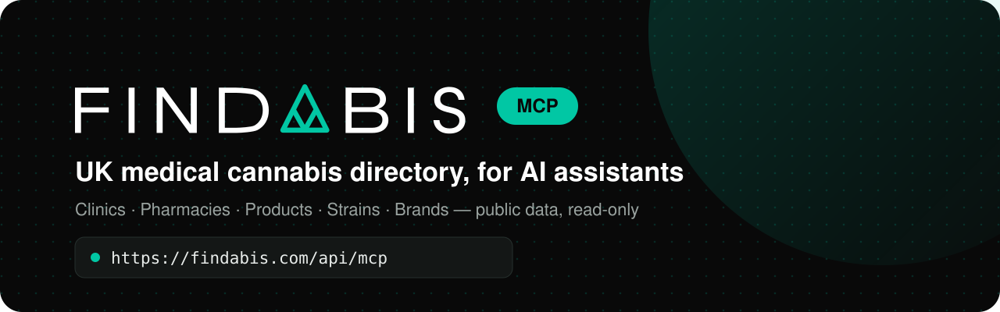

<div align="center">

<picture>
  <source media="(prefers-color-scheme: dark)" srcset="assets/banner-dark.svg">
  <source media="(prefers-color-scheme: light)" srcset="assets/banner-light.svg">
  
</picture>

<br/>

[](https://registry.modelcontextprotocol.io/)
[](#the-tools)
[](#what-it-can-and-cant-see)
[](LICENSE)

</div>

## What is this?

[Findabis](https://findabis.com) is a directory of UK medical cannabis clinics, pharmacies and products.

This MCP server lets AI assistants like Claude and ChatGPT look things up in it directly, so answers about clinics, prices and products come from current data rather than guesswork.

It's hosted, so there's nothing to install or run.

## Getting started

Add this URL to your AI assistant:

```
https://findabis.com/api/mcp
```

That's it. No account, no API key.

**Claude** (claude.ai or the desktop app): Settings → Connectors → *Add custom connector*, call it Findabis, paste the URL.

**Cursor:** [Add to Cursor](https://cursor.com/en/install-mcp?name=findabis&config=eyJ1cmwiOiJodHRwczovL2ZpbmRhYmlzLmNvbS9hcGkvbWNwIn0=) — one click, or install it as a plugin: this repo follows the [Agent Plugins](https://agent-plugins.org) standard (`plugin.json` + `mcp.json`).

**Gemini CLI:** `gemini extensions install https://github.com/Findabis/MCP`

**Claude Code:**

```bash
claude mcp add --transport http findabis https://findabis.com/api/mcp
```

<details>
<summary><b>Cursor, VS Code and everything else</b></summary>

<br/>

Cursor (`~/.cursor/mcp.json`):

```json
{
  "mcpServers": {
    "findabis": { "url": "https://findabis.com/api/mcp" }
  }
}
```

VS Code (`.vscode/mcp.json`):

```json
{
  "servers": {
    "findabis": { "type": "http", "url": "https://findabis.com/api/mcp" }
  }
}
```

Anything else that speaks MCP: use streamable HTTP at the URL above. The registry card lives at
[`/.well-known/mcp/server.json`](https://findabis.com/.well-known/mcp/server.json), and there's a copy in [`server.json`](server.json).

</details>

## Things you can ask

- *"Which clinics near Leeds do video consultations, and what's the first appointment?"*
- *"Compare these three clinics on what a new patient pays in the first year."*
- *"What's actually in this oil — carrier oil, allergens, THC and CBD?"*
- *"Find me pharmacies near SW1A that deliver."*

## The tools

There are nine, and they all just read:

| Tool | What it's for |
|---|---|
| `find_clinics` | Clinics that can prescribe, nearest first from a postcode or town, with fees, consultation types, CQC rating and reviews |
| `find_pharmacies` | Pharmacies that dispense a prescription you already have, with delivery and collection |
| `find_products` | Products by name, brand, strain or form, with THC/CBD and the latest published UK price |
| `get_product` | Everything public about one product: strength, terpenes, ingredients, allergens, leaflets |
| `find_strains` | Strain profiles by name or genetics |
| `find_brands` | The brands behind UK products, by name or dose form, with how many products each lists |
| `get_listing` | One clinic, pharmacy, strain or brand page in full |
| `compare_providers` | Two to six clinics or pharmacies side by side |
| `search_findabis` | One search across the lot, when you're not sure what you're looking for |

The list tools return up to 25 at a time; pass `offset` for the next page (each answer says where it starts).

## What it can and can't see

- It only sees what's already public on findabis.com. No accounts, no patients, no personal data — ever.
- It can't book, buy, change or send anything.
- It doesn't share stock levels, which pharmacy holds what, or per-pharmacy medicine prices. Those stay with patients and professionals who are signed in.
- Please be gentle with it: 60 requests a minute per client is plenty for normal use. Bulk-copying the directory isn't allowed under the [Findabis Terms](https://findabis.com/policies/terms).

## The important bit

> [!IMPORTANT]
> Findabis is a directory, not a clinic or a pharmacy, and nothing here is medical advice. It tells you what providers offer, never what anyone should take. That's a conversation for you and a specialist doctor.
>
> In the UK, cannabis-based medicines are prescription only, and only a specialist can prescribe them. Having cannabis without a prescription is still an offence.

The server tells your AI assistant all of this at the start of every session, so it should pass it on too.

## Found a problem?

If it's a security issue, please email **info@findabis.com** rather than opening a public issue — there's more in [SECURITY.md](SECURITY.md). For anything else (wrong data, a missing clinic, ideas), issues are very welcome.

## Source code

The code behind the public server is in [`src/`](src), so you can see exactly what each tool does and what it returns.

It runs inside the Findabis app and uses the app's own database and helpers, so it won't run on its own from this repo. It's here so it can be read and checked. Findabis's internal tools aren't included.

| Where | What |
|---|---|
| [`src/app/api/mcp/route.ts`](src/app/api/mcp/route.ts) | The endpoint: rate limits and the connection |
| [`src/server/mcp/publicServer.ts`](src/server/mcp/publicServer.ts) | Registers the tools with their read-only hints |
| [`src/server/mcp/tools/public/`](src/server/mcp/tools/public) | The nine tools and the shape of what they return |
| [`src/server/mcp/disclaimer.ts`](src/server/mcp/disclaimer.ts) | The medical disclaimer every session gets |

## Licence

The files in this repo are [MIT](LICENSE). The directory data the server returns isn't — that's covered by the [Findabis Terms](https://findabis.com/policies/terms). And the Findabis name and logo are ours, so please don't use them as your own.

<br/>

<div align="center">


<sub>Made in the UK by <a href="https://findabis.com">Findabis</a> · say hi to the cat 🐾</sub><br/>
<sub>Findabis Ltd · Company no. 16806797 · ICO ZC265580 · <a href="CHANGELOG.md">Changelog</a></sub>

</div>
